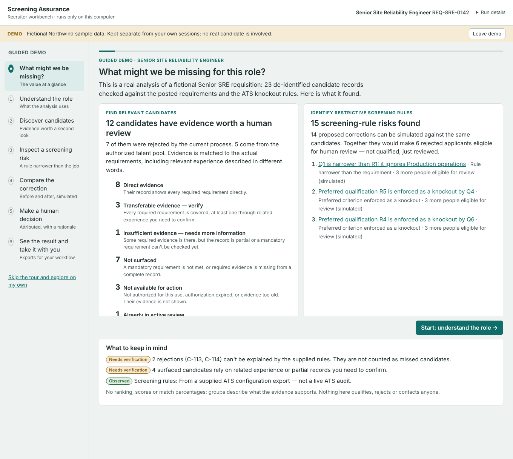

# Screening Assurance

**A screening-quality and talent-intelligence layer for existing ATS platforms.**

> Do not lower the bar. Improve the organization's ability to recognize who can clear it.

Screening Assurance works alongside an applicant tracking system. It inspects how job requirements are
expressed, how screening rules interpret them, and which applicants those rules may be excluding — then
gives recruiters evidence-backed, traceable recommendations to accept, reject or defer. It never replaces
the ATS, never becomes a system of record, and never rejects, advances or hires anyone.

This repository is the **first engineering milestone (MVP)** from the [product blueprint](docs/product-blueprint.md).
It is built to prove one thing:

> *Can we identify and validate preventable screening exclusions using knowledge that can change without code changes?*

| Milestone component | Where |
|---|---|
| Knowledge contracts for synonyms, equivalencies and skills — provenance, context, non-equivalencies, versions | [`src/screening_assurance/schemas/`](src/screening_assurance/schemas), [`knowledge/`](knowledge) |
| Diagnostic engine: requisition + screening rules (+ authorized candidate evidence) → traceable findings | [`src/screening_assurance/engine/`](src/screening_assurance/engine) |
| Evaluation harness with conventional and nontraditional candidates, before/after comparison when knowledge changes | [`evals/`](evals), [`src/screening_assurance/evals/`](src/screening_assurance/evals) |
| Human review report separating confirmed inconsistencies from potential missed-talent opportunities | [`src/screening_assurance/report/`](src/screening_assurance/report), [`samples/`](samples) |
| Pilot measurement plan + outcome measurement (measured vs. estimated, separately) | [`docs/pilot-measurement-plan.md`](docs/pilot-measurement-plan.md), [`src/screening_assurance/measure/`](src/screening_assurance/measure) |
| Design-partner validation: independently reviewed datasets, baseline vs. product, explicit unknowns, versioned results | [`docs/validation.md`](docs/validation.md), [`src/screening_assurance/measure/validation.py`](src/screening_assurance/measure/validation.py), `sa measure` |
| Forward screening assurance: screening-risk categories and before/after correction simulation | [`src/screening_assurance/engine/risks.py`](src/screening_assurance/engine/risks.py), [`docs/screening-risks.md`](docs/screening-risks.md) |
| Candidate rediscovery over an authorized pool + local recruiter workbench | [`src/screening_assurance/engine/discovery.py`](src/screening_assurance/engine/discovery.py), [`src/screening_assurance/workbench/`](src/screening_assurance/workbench), [`docs/workbench.md`](docs/workbench.md) |

Deliberately **not** built yet (per the blueprint): ATS API integrations, an elaborate dashboard, a large
general-purpose ontology, language-model extraction. The integration contract is specified in
[`docs/integration-contract.md`](docs/integration-contract.md) so connectors can follow once the loop is proven.

---

## Recruiter workbench and guided demo

A local web workspace for recruiters. It runs only on your computer (bound to `127.0.0.1`) and uses the same
deterministic engine and versioned knowledge as the CLI; the browser code only displays results and posts decisions.

```bash
pip install -e .
sa workbench                      # opens http://127.0.0.1:8765/ ; workspace data goes to ./workspace
```

The start screen offers two paths:

- **Try the guided demo** — one click opens a fictional sample requisition, validates and analyses it, and walks you
  through *What might we be missing?* → the role → a candidate's evidence → a screening-rule risk → the simulated
  correction → your attributed decision → exports. No ATS, no setup, no personal data; demo sessions are labelled and
  kept apart from your own.
- **Review my requisition** — add your own authorized, de-identified files; each is checked as you choose it, and
  **Analyse** runs it.

See [docs/walkthrough.md](docs/walkthrough.md) for the guided steps (with screenshots), the evidence labels
(*Observed*, *Simulated*, *Needs verification*, *Protected requirement*) and the audit of the previous journey.



Outside the tour, the same requisition has five views — Overview, The role, Candidates, Screening rules, Decisions &
export — that can be used in any order. Decisions carry over between runs by stable ids, earlier runs can be
**verified** byte for byte from their stored inputs and knowledge snapshot, and knowledge administrators can run the
evaluation suite from *Decisions & export*.

**Screening risks (look forward).** In the same session, **Screening rules** shows where the supplied rules may
exclude people whose evidence could meet the requirement. Pick *Q1 is narrower than R1*: you see the requirement
and the rule, the evidence, a proposed correction, and a deterministic **before/after simulation** — who the supplied
rule excludes, who would pass the corrected rule, who still fails a mandatory requirement, whose evidence is
insufficient, whose relevance is not established, and who becomes newly eligible for human review. Authorized pool
records appear as clearly labelled hypotheticals. Record *Accept the concern* with a rationale, update the analysis, export the *screening-rule findings*, and
**Verify**. Protected requirements (the linehaul licence) are shown with no correction proposed.
Details and evidence limits: [docs/screening-risks.md](docs/screening-risks.md).

What the workbench will not do: contact anyone, write to an ATS, advance or reject candidates, rank people,
or treat a prior application as permission to contact. See [docs/workbench.md](docs/workbench.md) for the
data boundaries, the candidate-pool contract and the security model.

## Quick start (CLI)

```bash
pip install -e ".[dev]"          # Python 3.10+; dependencies: PyYAML, jsonschema

sa knowledge validate            # schema + referential validation of the knowledge pack
sa diagnose examples/northwind/requisitions/REQ-SRE-0142 --out out
open out/REQ-SRE-0142/report.html   # review findings, record decisions, export decisions.yaml

sa eval                          # regression suite against expert-labeled cases
sa eval-compare --baseline release:1.0.0 --candidate pack   # what changed when knowledge changed
sa portfolio examples --out out  # portfolio overview across requisitions
sa discover examples/northwind/requisitions/REQ-SRE-0142 --out out   # rediscovery from the CLI
sa measure evals/validation/northwind-synthetic.yaml   # validation against independently reviewed cases (synthetic here)
pytest                           # 159 tests
```

Pre-rendered output for every example is committed under [`samples/`](samples) (`make samples` regenerates it).

## The assurance loop

`Connect → Define → Diagnose → Review → Correct → Observe → Learn`

| Step | In this MVP |
|---|---|
| **Connect** | A requisition export (`requisition.yaml`), employer `policy.yaml`, and optionally authorized, de-identified `candidates.yaml`. `inputs_received` records what was actually supplied; the report never claims to have audited ATS configuration it did not see. |
| **Define** | Each requirement gets a proposed classification — *essential*, *preferred*, *demonstrable through alternatives*, or *unverified assumption* — with its basis. Human classification decisions feed back into the next run. |
| **Diagnose** | Deterministic checks over requirements and rules; deterministic simulation of each rule against candidate evidence, before and after each proposed correction. |
| **Review** | Markdown and self-contained HTML reports. The HTML report captures accept / reject / defer / reclassify decisions with a mandatory rationale and exports `decisions.yaml`. |
| **Correct** | `changes.yaml` lists suggested configuration changes for *accepted* findings only. Nothing is applied automatically. |
| **Observe** | `outcomes.yaml` (baseline, after-change period, recruiter reviews) produces Level 3 measured findings, with measured and estimated value reported separately. |
| **Learn** | Reviewers can flag decisions as knowledge proposals (`sa propose-from-decisions`). Proposals never change production knowledge until an administrator ships a reviewed, evaluated release. |

## Evidence levels

Every finding belongs to exactly one level; they are never collapsed into a single score.

| Level | Meaning | Examples of checks |
|---|---|---|
| **1 · Demonstrable inconsistency** | The supplied materials themselves establish the discrepancy. | `threshold_inconsistency`, `preferred_enforced_as_knockout`, `equivalent_path_blocked`, `rule_narrower_than_requirement`, `unstated_requirement_enforced`, `credential_stricter_than_requirement` |
| **2 · Plausible missed-talent risk** | Knowledge or evidence suggests a risk; human judgement is required. | `literal_term_missing_variants`, `experience_path_narrower`, `alternatives_not_considered`, `unverified_necessity`, `candidate_review_opportunity`, `unexplained_exclusions` |
| **3 · Measured impact** | Humans reviewed the affected candidates and outcomes were recorded. | `measured_impact` |

Each finding carries: id (stable across knowledge versions, so decisions carry over), requisition and source-rule
references, knowledge fingerprint, observation, supporting evidence with source locations, confidence,
limitations, proposed action, expected benefit, trade-off, the candidates it affects in the supplied sample,
and the human disposition.

## Guardrails (enforced in code and tested)

- **Human authority.** Corrections are simulated, never applied. A finding a human rejects or marks
  *confirmed necessary* stops influencing which candidates are surfaced.
- **Protected requirements.** Regulated credentials (knowledge `kind: regulated_credential`) and employer
  non-negotiables never get an alternative path. Only spelling variants of the license itself are recognized.
  Knowledge validation refuses any equivalency that targets a regulated credential.
- **Similar ≠ equivalent.** Equivalencies require specific indicators in the same sentence, required indicators,
  minimum duration, and disqualifying terms (`participated`, `drill`, `shadowed`…). Closely related terminology is
  shown to reviewers but never counts as satisfying a requirement. Skill combinations count only when a role
  states the capability *and* accepts alternatives.
- **Surfacing is conservative.** A candidate is surfaced only if the ATS excluded them, the supplied rules
  explain it, they pass every rule after the proposed corrections, and every required requirement has evidence.
  The report states that qualification has not been established, and never shows a match percentage.
- **Employer policy overrides general knowledge.** Accepted and rejected equivalencies are per employer and
  job family.
- **No protected characteristics.** The candidate contract rejects names, contact details and
  protected-characteristic fields, and requires `de_identified: true`.
- **Honest inputs.** Recruiter-documented rules, sampled candidate data, and exclusions the supplied rules
  cannot explain are disclosed as limitations, not hidden.

## Knowledge is data, not code

Three independently maintained YAML documents with JSON Schema contracts:

- [`synonyms.yaml`](knowledge/pack/synonyms.yaml) — canonical terms, variants, contexts, relationship type
  (`equivalent_terminology` vs `closely_related`), ambiguities, context exclusions, constraint, provenance.
- [`equivalencies.yaml`](knowledge/pack/equivalencies.yaml) — target capability, alternative evidence as
  deterministic indicators, conditions, validation steps, limitations, explicit non-equivalencies, confidence.
- [`skills.yaml`](knowledge/pack/skills.yaml) — skills with kind, relationships (`closely_related`,
  `prerequisite`, `supports`, `transferable`, `not_equivalent`), evidence types, plus capability combinations.

Lifecycle (see [`docs/knowledge-authoring.md`](docs/knowledge-authoring.md)):
edit → `sa knowledge validate` → bump versions → `sa eval` → `sa eval-compare` → approve in `manifest.yaml`
→ `sa knowledge release` (eval-gated, checksummed snapshot) → `sa knowledge promote` (eval-gated, recorded)
→ `sa knowledge rollback` if results deteriorate.

The repository ships two releases. **1.1.0** (production) added military and healthcare incident-leadership
vocabulary, production-reliability title variants, and a B2B account-management equivalency, after the
pilot cases showed 1.0.0 missing them:

| Metric (4 labeled cases) | 1.0.0 | 1.1.0 |
|---|---|---|
| Expected findings produced | 25 / 28 | 28 / 28 |
| Qualified excluded candidates surfaced (recall) | 0.8 | 1.0 |
| Candidates surfaced that experts judged unqualified | 0 | 0 |
| Guardrail / forbidden-finding violations | 0 | 0 |

The suite also evaluates **candidate rediscovery** on synthetic fixtures (`evals/discovery/`): relevant surfaced
and missed, irrelevant surfaced, over-claimed certainty, mandatory-requirement and blocked-record violations,
and how many results need human verification. Under 1.0.0 two relevant candidates are missed (recall 0.846);
1.1.0 surfaces them (1.0) without surfacing anyone who lacks the legally required license. Screening-risk simulations
are scored the same way, plus 17 labelled scenario expectations (narrow rule, preferred-as-knockout, terminology,
valid and unsupported alternatives, mandatory blocking, insufficient evidence, irrelevant pass-through, rule-level
only): 1.0.0 meets 15 of 17 (recall 0.778), 1.1.0 meets all 17, with no irrelevant or mandatory violations.

These figures come from **illustrative cases authored alongside the seed knowledge**; they show the harness
working, not real-world accuracy. Establishing that requires design-partner data — see the
[pilot measurement plan](docs/pilot-measurement-plan.md). The test suite also proves the gate catches a
harmful edit (treating "Bash" as infrastructure-as-code surfaces an unqualified candidate and fails the gate).

## Repository layout

```
src/screening_assurance/
  schemas/            JSON Schema data contracts (knowledge, requisition, candidates, policy, decisions, outcomes, eval cases, proposals)
  knowledge/          pack loading/indexing, validation, diff, release/promote/rollback registry
  engine/             interpret (normalize + knowledge), checks (design findings), rules (simulation), candidates, orchestration
  measure/            outcome & investment measurement (Level 3); validation.py: design-partner validation datasets
  report/             markdown + HTML requisition reports, discovery section, change proposals, portfolio overview
  workbench/          local web workbench: workspace (sessions, runs, decisions, exports, retention) + loopback server + static UI
  evals/              evaluation harness and knowledge comparison
  cli.py              `sa` command
knowledge/            pack/ (working copy), releases/<ver>/, deployments.yaml, proposals/
examples/northwind/   fictional employer: policy + 4 requisitions (SRE, customer success, linehaul w/ protected license, pre-publication RevOps),
                      with authorized candidate pools for SRE and linehaul
evals/                labeled screening cases, synthetic discovery cases, regression thresholds, synthetic validation dataset
samples/              committed output of `make samples`
docs/                 blueprint, architecture, knowledge authoring, pilot measurement plan, integration contract
tests/                pytest suite
```

## Documentation

- [Product blueprint](docs/product-blueprint.md) — strategy, boundaries, workflow, commercial model.
- [Architecture](docs/architecture.md) — engine stages, data flow, determinism, extension points.
- [Knowledge authoring](docs/knowledge-authoring.md) — how to write and ship knowledge safely.
- [Pilot measurement plan](docs/pilot-measurement-plan.md) — acceptance criteria and how to tell whether surfaced candidates are genuinely qualified and recruiter effort is justified.
- [Integration contract](docs/integration-contract.md) — what an ATS connector must provide, and the audit/retention rules.
- [Workbench](docs/workbench.md) — the recruiter workflow, candidate-pool contract, discovery groups, data boundaries and security model.
- [Validation](docs/validation.md) — measuring against independently reviewed design-partner cases: dataset contract, `sa measure`, metric definitions, limitations.
- [Screening risks](docs/screening-risks.md) — forward screening assurance: risk categories, correction simulation, evidence limits, decision history.
