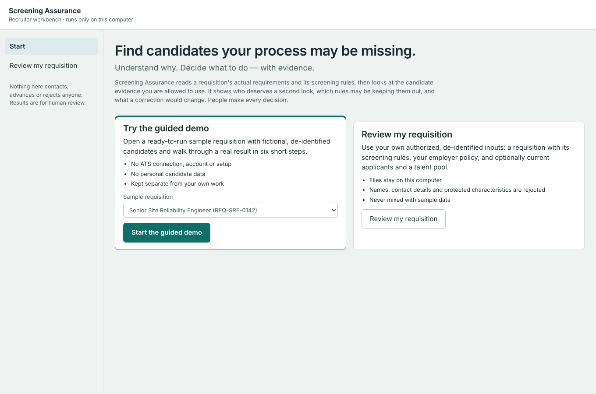
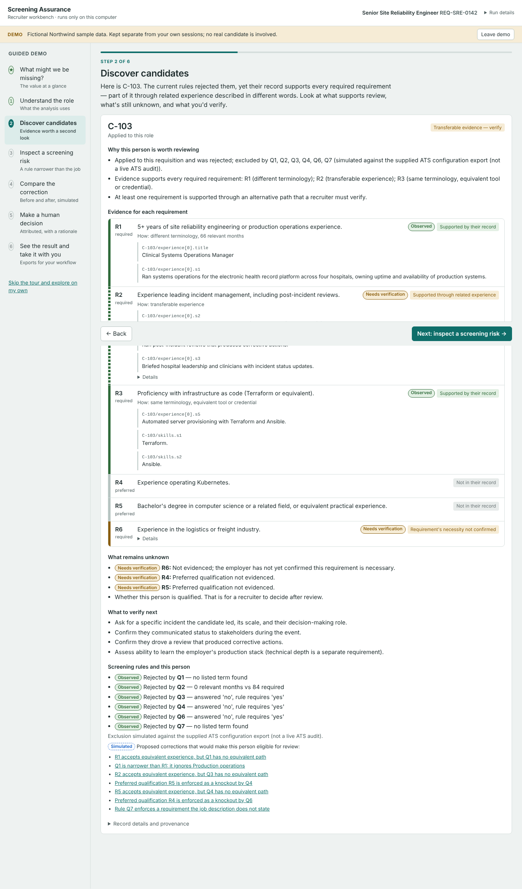
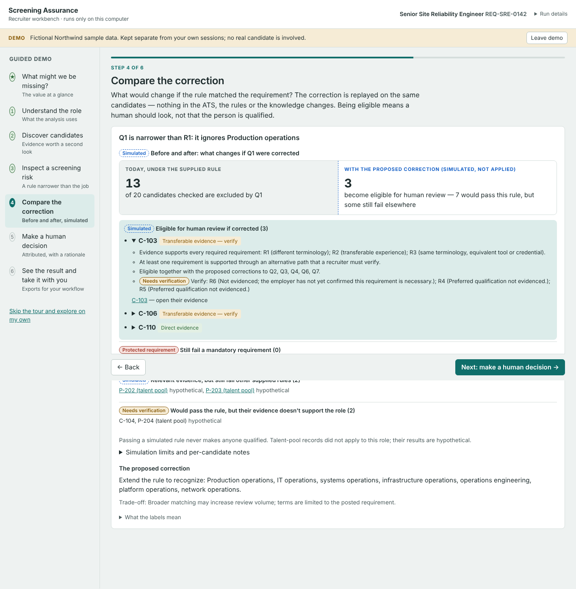
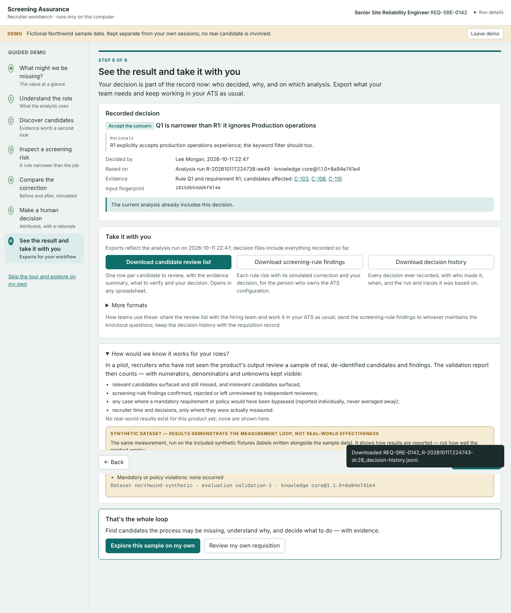

# Recruiter value walkthrough

This guide covers the guided demo in the local workbench: a recruiter can launch the product, follow one sample
requisition, and see in a few minutes what Screening Assurance finds and why. Everything on screen comes from
the deterministic engine, the versioned knowledge and the existing review workflow. There are no mock-ups and no
prepared numbers.

> **Promise:** find candidates your process may be missing. Understand why. Decide what to do — with evidence.

## Start it

From a fresh checkout (Python 3.10+):

```bash
pip install -e .
sa workbench          # opens http://127.0.0.1:8765/ in your browser
```

Run the command from the repository root, so that the included `examples/`, `knowledge/` and `evals/` are found.
The guided demo needs no further CLI commands, no ATS connection and no personal data.



The start screen offers two paths:

- **Try the guided demo.** Opens a ready-to-run sample requisition built from fictional, de-identified data. The
  Senior SRE requisition is the default; the Linehaul supervisor and the Customer Success requisitions can also be
  chosen. The workbench validates the sample through the normal data contracts and runs it with the production
  knowledge. Recorded outcomes are left out, so the demo shows what the product finds, not invented results.
- **Review my requisition.** Upload your own authorized inputs. Each file is checked as soon as it is chosen; the
  screen says what is missing and what to fix. **Analyse** then creates the session and runs it in one step.

Demo sessions and your own sessions are kept apart. A session's mode comes from its source and never changes:
sample data is always `demo`, an upload is always `real`. Demo sessions carry a *Demo* banner and are listed
separately under *Previous demo sessions*. Nothing starts the tour automatically, so returning users go straight
to their sessions.

## The guided steps

The tour has a progress indicator, **Back** and **Next** on every step, a step list you can jump around in, and
**Skip the tour and explore on my own**. You can return to it at any time with **Resume guided tour** in the demo
banner. The candidate and the finding shown are chosen from the run by
`screening_assurance.workbench.walkthrough.tour_selection`. The selection prefers an applicant who was rejected by
the supplied rules and whose evidence supports review through related experience, together with the rule-level
finding whose simulated correction makes that person eligible for review.

| Step | What you see (SRE sample) | Why it matters |
|---|---|---|
| **What might we be missing?** | 12 of 23 records have evidence worth a human review; 7 of them were rejected by the current process and 5 come from the talent pool. 15 screening-rule risks were found, and 14 corrections can be simulated. The three rules with the largest effect come first. Unexplained rejections (C-113, C-114) are marked *needs verification*, not counted as missed candidates. | Both capabilities applied to one requisition, in counts a recruiter can check. |
| **1. Understand the role** | Requirements (required or preferred, equivalents accepted, protected), the seven supplied rules and their source (*from a supplied ATS configuration export — not a live ATS audit*), the evidence used and never used, and the employer policy. | The analysis uses only what was supplied. |
| **2. Discover candidates** | **C-103**, a clinical systems operations manager rejected by Q1–Q4, Q6 and Q7: the evidence for each requirement with quoted source sentences, what is still unknown (R6 not evidenced, necessity unconfirmed), what to verify next, and the corrections that would make them eligible for review. | Relevant experience described in other words. |
| **3. Inspect a screening risk** | *Q1 is narrower than R1: it ignores Production operations.* A **rule-level** finding: the requirement, the supplied rule and why it matters. | Rule-level concerns are marked as distinct from candidate-specific results. |
| **4. Compare the correction** | Today, 13 of 20 candidates are excluded by Q1. With the correction (simulated, not applied), **3 become eligible for human review**: C-103, C-106 and C-110, each expandable to their evidence and what to verify. 0 bypass a mandatory requirement; 2 talent-pool records still fail other rules (hypothetical); 2 would pass the rule but their evidence doesn't support the role. | What changes, and what doesn't, without touching any rule. |
| **5. Make a human decision** | Accept, reject, defer or request evidence, with a required rationale and your name. The decision uses the existing finding-decision contract and is stored with the run, the knowledge fingerprint and an input fingerprint. | People decide. Nothing is changed in the ATS, the rules or the knowledge. |
| **6. See the result and take it with you** | The recorded decision with its rationale, run and inputs. **Update the analysis** applies it. Downloads: candidate review list (CSV), screening-rule findings and decision history, with more formats underneath. *How would we know it works for your roles?* explains what a pilot measures. | Fits the existing recruiting workflow: share the list, send rule findings to the configuration owner, keep the history. |






## Evidence labels

Findings and simulations use four labels, always as text and colour together. A legend is available on each step.

| Label | Meaning |
|---|---|
| **Observed** | Directly supported by the supplied records or evidence. |
| **Simulated** | The result of applying a proposed correction to the supplied inputs. Nothing was changed. |
| **Needs verification** | Cannot be established from the available evidence; a person has to check it. |
| **Protected requirement** | A mandatory condition that no proposed correction can bypass (for example the linehaul licence). |

Short explanations come first. Source rule logic, finding IDs, evidence levels, confidence, knowledge records and
run IDs are under *Technical provenance*, *Record details and provenance* and the header's *Run details*.

## Validation, honestly

The final step explains what a design-partner pilot measures. These measures come from the existing `sa measure`
contract (see [validation.md](validation.md)): relevant candidates surfaced and missed, irrelevant candidates
surfaced, findings confirmed or rejected by independent reviewers, and violations reported individually. If you
open the section, it runs the same measurement on the included **synthetic** dataset and shows its label verbatim
(*SYNTHETIC DATASET — results demonstrate the measurement loop, not real-world effectiveness*). It shows the
counts that make uncertainty visible, such as unreviewed findings and candidates without a resolved label. It does
not lead with success rates, and it states that no real-world results exist yet.

## Audit: friction found in the previous journey

The previous workbench (four views: intake, discovery, screening risks, review and export) was walked through from
launch to export. These were the friction points, and how this change handles each:

| Friction | Where | Change |
|---|---|---|
| No starting point: four internal requisition IDs with equal-weight **Load** buttons, next to an upload form | Start | One start screen with the product promise and two plain choices; a single **Start the guided demo** button. |
| Blocked before seeing anything: **Load** failed with a toast until a name was typed in the header | Start | The demo needs no name. A name is asked for inline where attribution matters: decisions, real-session creation and runs. |
| Internal terminology up front: sha256 fingerprints, a *Knowledge revision* dropdown showing `core@1.1.0+8a94e741e4`, *Level 1*, *Confidence high*, *Include recorded outcomes* | Intake, findings | Defaults to production knowledge under *Advanced*. Fingerprints, levels and confidence moved to *Technical details* and provenance. Plain scope labels (*Rule-level*, *Candidate-specific*). |
| Value had to be inferred: the first screen after a run was a list of 23 findings or a count strip | Discovery, risks | New **Overview**: *What might we be missing for this role?*, with both capabilities on one requisition. |
| Connecting a finding to candidate evidence meant switching views and matching IDs | Risks to discovery | Newly eligible candidates expand inline with their evidence summary and what to verify. Candidate detail lists the corrections that would make them eligible. |
| Before/after was a seven-row table of category labels and IDs | Simulation | Readable before/after comparison plus outcome buckets labelled *Simulated*, *Protected requirement* and *Needs verification*. Talent-pool results are marked hypothetical. |
| Discovery vs. screening risk vs. qualification unclear | Throughout | Overview frames them as two views of one requisition. Copy repeats that eligible for review is not qualified. |
| Unnecessary steps: separate *Validate inputs* and *Create session* clicks, then a separate run | Upload | Files are validated as soon as they are chosen; **Analyse** creates and runs the session. |
| Twelve equal export buttons | Review | Three primary exports with what each is for; the rest under *More formats*. |
| Stale decisions and changed knowledge described in internal terms | Review | Plain-language reasons (*the knowledge used for matching was updated*, *the input files changed*). |
| Sample sessions mixed with a recruiter's own | Sessions | `mode` (`demo` or `real`) on every session, with separate lists and banners. |
| Fresh checkout worked, but nothing pointed a first-time user to the demo | Docs | This guide and the README quick start. |

Unchanged: the engine, knowledge, simulation, decision contracts, exports, retention, reproducibility verification
and the security model (loopback only, per-launch token, Host check, CSP without inline script or style, body
limits, textContent rendering).

## What the walkthrough does not do

It does not rank or score people, show match percentages, contact anyone, write to an ATS, apply a correction or
change knowledge. Being eligible for review is never presented as being qualified.

All screenshots are of the current implementation, captured in Chromium at 1360×900 against a fresh workspace.
